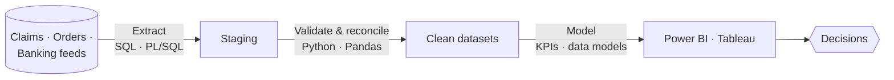

<div align="center">


[LinkedIn](https://linkedin.com/in/bairi-poojitha-3b225a1b3) · Open to Data Analyst, Analytics Engineer and Data Engineer roles

</div>

```sql
-- Hi, I'm Poojitha (Pooji). Run this query to get to know me.
SELECT name, role, experience, domains, superpower
FROM   github.profiles
WHERE  username = 'bairipoojitha1299';
```

```text
+----------+--------------------------------------+------------+------------------------------+---------------------------------+
| name     | role                                 | experience | domains                      | superpower                      |
+----------+--------------------------------------+------------+------------------------------+---------------------------------+
| Poojitha | Data Analyst · Analytics Engineer    | 4+ years   | Healthcare claims, Banking,  | Raw data → validated pipeline → |
|          |                                      |            | Order management & finance   | dashboard → business decision   |
+----------+--------------------------------------+------------+------------------------------+---------------------------------+
(1 row)
```

## How I work



## Impact report

```sql
SELECT metric, result FROM impact ORDER BY proud_of DESC;
```

| metric | result |
|---|---|
| Healthcare claims processed into clean datasets | **2M+ records / month** |
| Ad hoc data delivery time | **days → under 4 hours** |
| Downstream data accuracy (automated quality rules) | **+18%** |
| Reporting turnaround (Oracle EBS pipelines) | **same-week → same-day** |
| Banking issue diagnosis time | **1 day → under 3 hours** |
| Recurring production problems | **-25%** |
| Manual reporting effort | **-20 to 40%** |

## Featured projects

```sql
SELECT project, stack, headline_finding FROM portfolio ORDER BY featured;
```

| project | stack | headline finding |
|---|---|---|
| [**Real-Time Payments Pipeline**](https://github.com/bairipoojitha1299/payments-streaming-pipeline) · streaming card transactions, every 5 min | Kafka · Airflow · Snowflake · dbt · Docker | Event contract + dead-letter queue, at-least-once delivery with dedup in Snowflake, idempotent loads, freshness and latency monitoring |
| [**Credit Card Fraud Detection**](https://github.com/bairipoojitha1299/card-fraud-detection) · 1.85M transactions, SQL features + rules + ML + dashboard | PostgreSQL · Python · scikit-learn · Streamlit | Model catches **98%** of fraud with **6× fewer alerts** than rules; ~$1.1M net savings on the test period |
| [**Olist ELT Pipeline**](https://github.com/bairipoojitha1299/olist-elt-pipeline) · raw CSVs → tested star schema, daily | Airflow · dbt · PostgreSQL · Docker · GitHub Actions | 550k rows loaded via COPY, 40+ dbt data tests, incremental fact table, CI on every push |
| [**Brazilian E-Commerce Sales Analysis**](https://github.com/bairipoojitha1299/olist-ecommerce-analysis) · 100k real orders, 15 business questions | PostgreSQL · Python · Docker | Deliveries 8+ days late average **1.7** vs **4.3** when early; **97%** of customers never reorder |

## Experience: `git log --oneline`

```text
* 2026-05  (HEAD -> main)  Data Analyst @ Humana · healthcare claims & provider analytics
* 2025-01  Graduate Assistant @ Texas State University · admissions data quality & reporting
* 2022-11  Analytics Engineer @ Infosys (client: Sony) · Oracle EBS order management & finance
* 2021-10  Analytics Engineer @ Infosys (client: Bank of America) · transaction analytics
* init     M.S. Data Analytics & Information Systems · Texas State University · 4.0 GPA
```

## Data catalog: my stack


| Layer | Tools |
|---|---|
| **Query & Code** | SQL, PL/SQL, Python, Java, Bash |
| **Databases** | Oracle, SQL Server, MySQL, MongoDB |
| **Analyze & Visualize** | Power BI, Tableau, Excel |
| **Python libraries** | Pandas, NumPy, Matplotlib, Streamlit |
| **Cloud & Workflow** | AWS, Git, Linux, Jira |
| **Data engineering** | Snowflake, dbt, Apache Airflow, Apache Kafka, Docker |
| **AI (exploring)** | RAG, Vector Search, Groq API |

## Certifications

```sql
SELECT certification, issuer FROM credentials;
```

| certification | issuer |
|---|---|
| Google Data Analytics | Google · Coursera |
| Databases and SQL for Data Science with Python | IBM · Coursera |
| AWS Certified Cloud Practitioner | Amazon Web Services |
| Google AI Essentials | Google · Coursera |
| Neural Networks and Deep Learning | DeepLearning.AI · Coursera |
| Data Analysis and Visualization with Python | Jovian |

## Pipeline uptime (a.k.a. my commit streak)

<div align="center">

<br/><br/>

</div>

## Live log

```bash
$ tail -f /var/log/poojitha.log
[INFO]  Open to Data Analyst · Analytics Engineer · Data Engineer roles
[INFO]  Currently exploring: RAG, vector search & AI-powered analytics
[INFO]  Reach me: linkedin.com/in/bairi-poojitha-3b225a1b3
[WARN]  Will happily talk about data quality for too long
```

<div align="center"><sub>-- end of query · thanks for stopping by --</sub></div>
